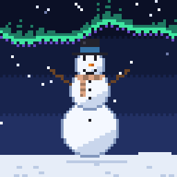
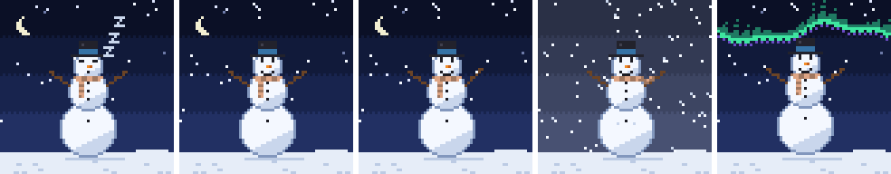

# git-snowman



git-snowman draws a pixel-art snowman from a GitHub account's public activity. Its languages color its scarf, hat and buttons, its contributions build it taller, its streaks earn it mittens, lights and a star, and the day that just ended decides whether it dozes, waves, braves a blizzard or hops under the northern lights. A nightly workflow puts the snowman on a profile README as a looping GIF, the same tool runs from the command line, and the Rust library underneath is published on crates.io.



## Repository structure

```
.
├── .github/      workflows, issue forms, and Dependabot
├── docs/         the getting-started guide and the render sheets
├── examples/     the profile workflow and the gallery generator
├── src/          the library and the git-snowman command
├── tests/        the public-boundary tests and their fixtures
└── action.yml    the GitHub Action
```

## Usage

### Requirements

- For a snowman on your profile README: a GitHub account. The Action runs in your profile repository's workflow with its built-in token.
- For the command line: a binary from the [releases page](https://github.com/SimenVangen/git-snowman/releases), or Rust at or above the `rust-version` in [Cargo.toml](Cargo.toml), plus the [GitHub CLI](https://cli.github.com/), authenticated.
- For the library: Rust at or above that same version.

[docs/getting-started.md](docs/getting-started.md) walks through all three: the Action in a profile workflow, the command line, and the library. [docs/render-sheets.md](docs/render-sheets.md) shows how activity maps to the snowman. The API is documented on [docs.rs](https://docs.rs/git-snowman).

### Quick start

In your profile repository, add [`examples/profile-workflow.yml`](examples/profile-workflow.yml) as `.github/workflows/snowman.yml`, put this in `README.md`, and run the workflow once from the Actions tab:

```markdown

```

## Author

- Email: [simenv@hotmail.no](mailto:simenv@hotmail.no)
- GitHub: [@SimenVangen](https://github.com/SimenVangen)

## License

MIT. See [LICENSE](LICENSE).
