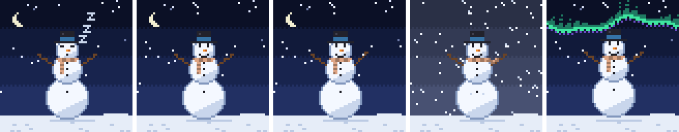
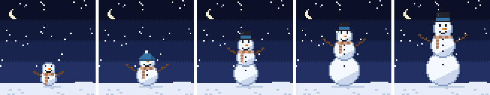
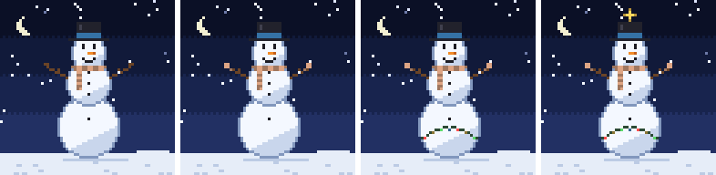

# Render sheets

These are drawn by [`examples/gallery.rs`](../examples/gallery.rs). Regenerate them after changing the art:

```sh
cargo run --example gallery --no-default-features
```

## Moods

The day that just ended sets the mood: the day before the last day on the contribution calendar.



| Contributions that day | Mood | What happens |
| --- | --- | --- |
| 0 | Dozing | Eyes shut, a few flakes, Zs drifting up |
| 1–3 | Calm | Light snowfall and the odd blink |
| 4–9 | Waving | Waves a stick arm |
| 10–19 | Blizzard | Grey sky, sideways snow, scarf flapping |
| 20+ | Aurora | Northern lights, and it hops |

## Sizes

Contributions over the past year build the snowman.



| Contributions | Size | Shape |
| --- | --- | --- |
| under 50 | Tiny | Two small snowballs |
| 50–199 | Small | Two snowballs and a beanie |
| 200–499 | Medium | Three snowballs and a top hat |
| 500–999 | Large | Taller |
| 1,000+ | Grand | Tallest |

## Marks

Streaks decorate it. Mittens and lights follow the current streak and come off when it breaks; the star stays for any 100-day streak in the past year.



| Streak | Mark |
| --- | --- |
| current 7+ days | Mittens, in the scarf's color |
| current 30+ days | Blinking string lights on the bottom snowball |
| any 100+ days this year | A twinkling gold star above the hat |

## Colors

The three most-written languages across the account's public, non-fork repositories, using GitHub's language colors. Languages without a color are skipped, and pale colors are darkened until they show up against snow.

| Language | Becomes |
| --- | --- |
| First | Scarf and mittens |
| Second | Beanie, or the top hat's band |
| Third | Buttons |

An account with no languages gets a red scarf, a green hat and coal buttons.
